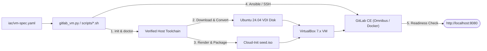

# GitLab on Proxmox VE & VirtualBox (`gitlab`)

> Declarative Infrastructure-as-Code (IaC) templates, Python CLI orchestrator, and standalone Bash scripts to manage an Ubuntu 24.04 LTS VM on **Proxmox VE** or **Oracle VirtualBox** and deploy a self-hosted GitLab CE server.

`gitlab` automates the full lifecycle of a self-hosted GitLab Community Edition (CE) instance running inside a **Proxmox VE** virtual machine (via REST API and QEMU Guest Agent discovery, with strict non-overwrite protection for existing VMs) or an **Oracle VirtualBox 7.x** virtual machine (`VBoxManage` CLI + `NoCloud` cloud-init image seeding), driven by a single declarative specification ([`iac/vm-spec.yaml`](iac/vm-spec.yaml)) and idempotent Ansible or SSH-based provisioning across macOS and Linux (`arm64` and `x86_64`).

---

## Quick Start

```bash
# 1. Clone the repository and (optionally) install the CLI into ~/.local/bin
git clone git@github.com:bsommers/gitlab.git
cd gitlab
./scripts/install.sh --local

# 2. Initialize config and run environment preflight checks
./gitlab_vm.py init
./gitlab_vm.py doctor

# 3. Preview commands, then create the VM, provision GitLab CE, and show the URL
./gitlab_vm.py --dry-run up
./gitlab_vm.py up
```

Visit `http://localhost:8080` — you will see the GitLab sign-in screen. Log in with username `root` and the initial password configured in [`iac/vm-spec.yaml`](iac/vm-spec.yaml) (default: `GitLabRoot!2026`).

---

## User Guide & Documentation

For complete task walkthroughs, operational recipes, CLI flags, configuration schemas, and troubleshooting, start with the **[User Guide (`docs/user-guide/README.md`)](docs/user-guide/README.md)**:

| Guide / Document | Description |
|------------------|-------------|
| **[User Guide (Index)](docs/user-guide/README.md)** | **Entry point to the 4-chapter User Manual** |
| ├─ [01. Getting Started](docs/user-guide/01-getting-started.md) | Host prerequisites, multi-scope installer (`--local`, `--global`, `--prefix`), `init → doctor → up` |
| ├─ [02. Examples & Recipes](docs/user-guide/02-examples-and-recipes.md) | Omnibus vs. Docker Compose, custom ports/RAM, Bridged LAN networking, CI scripts |
| ├─ [03. CLI & Config Reference](docs/user-guide/03-cli-and-config-reference.md) | Complete CLI flags, [`iac/vm-spec.yaml`](iac/vm-spec.yaml) schema, environment variables, and exit codes |
| └─ [04. Troubleshooting & FAQ](docs/user-guide/04-troubleshooting-and-faq.md) | Error diagnostics, remedies, root password recovery, and FAQ |
| [Documentation Hub](docs/README.md) | Central navigation index and recommended reading order |
| [Architecture](docs/ARCHITECTURE.md) | System design, clean boundaries, component map, data flows, state machine, ADRs |
| [Purpose](docs/PURPOSE.md) | Problem statement, goals, non-goals, and hypervisor trade-offs |
| [How-To Guide](docs/HOWTO.md) | Quick task-oriented recipes and lifecycle commands |
| [Product Brochure](docs/brochure.md) | Executive overview, value pillars, and visual system architecture |
| [Changelog](CHANGELOG.md) | Semantic version history and release notes |

---

## What It Does

- **Multi-Scope CLI Onboarding (`install.sh`, `init`, `doctor`, `guide`)**: Installs `gitlab-vm` into user home (`--local`), system-wide (`--global`), or custom prefixes (`--prefix DIR`), initializes starter specs (`init`), validates host tools and Proxmox API reachability with actionable remedies (`doctor`), and emits progressive `Next steps:` breadcrumbs to `stderr`.
- **Manages Proxmox VE VMs with Non-Overwrite Protection (`--provider proxmox`)**: Inspects target Proxmox VE nodes via REST API by both VM `name` (`gitlab-server`) and `vmid` (`112`) before any clone, disk resize, or Cloud-Init operation—refusing to overwrite, re-clone, or destroy an existing VM when `proxmox.protect_existing: true`.
- **Provisions VirtualBox Linux VMs via CLI (`VBoxManage`)**: Downloads the official Ubuntu 24.04 LTS (`noble`) cloud image matching the host CPU architecture (`arm64` or `amd64`), converts and resizes it to a 40 GB VDI disk via `qemu-img` and `VBoxManage`, and boots the VM headlessly with EFI firmware and VirtIO storage/networking.
- **Bootstraps Guest OS via Cloud-Init (`NoCloud`)**: Generates a `cidata` ISO image containing rendered `user-data` and `meta-data` templates (`iac/cloud-init/`), injecting a dedicated Ed25519 SSH keypair, configuring a 4 GB swapfile, applying kernel `sysctl` parameters (`vm.swappiness=10`, `kernel.shmall=4194304`), and enabling `openssh-server`.
- **Deploys GitLab CE via Omnibus or Docker Compose**: Provisions GitLab Community Edition inside the VM using either the idempotent Ansible playbook ([`iac/ansible/playbook.yml`](iac/ansible/playbook.yml)) or the standalone Bash installer ([`scripts/install-gitlab.sh`](scripts/install-gitlab.sh)), with single-VM memory tuning for Puma (`worker_processes=2`) and Sidekiq (`concurrency=10`).
- **Discovers and Verifies Connection URLs**: Queries the Proxmox QEMU Guest Agent (`network-get-interfaces`) or VirtualBox NAT forwarding rules (`VBoxManage showvminfo --machinereadable`), probes HTTP readiness on `/users/sign_in`, and outputs human-readable banners, raw URLs (`--raw`), or machine-readable JSON (`--json`).

---

## Architecture Overview

```text
          ┌─────────────────────────────────────────────────────────────────┐
          │                    Host Workstation (macOS / Linux)             │
          │                                                                 │
  YAML    │  ┌──────────────────┐      ┌─────────────────────────────────┐  │
 ────────►│  │  iac/vm-spec.yaml│─────►│  gitlab_vm.py / scripts/*.sh    │  │
          │  └──────────────────┘      └───────┬─────────────────┬───────┘  │
          │                                    │                 │          │
          │                         VBoxManage │                 │ Ansible  │
          │                         + hdiutil  │                 │ or SSH   │
          └────────────────────────────────────┼─────────────────┼──────────┘
                                               │                 │
                                     ╔═════════▼═════════════════▼══════════╗
                                     ║   VirtualBox 7.x VM (gitlab-server)  ║
                                     ║   Ubuntu 24.04 LTS (EFI + VirtIO)    ║
                                     ║                                      ║
                                     ║  ┌──────────────┐  ┌──────────────┐  ║
                                     ║  │  cloud-init  │  │  GitLab CE   │  ║
                                     ║  │ (seed.iso)   │  │ :8080 / :22  │  ║
                                     ║  └──────────────┘  └──────────────┘  ║
                                     ╚══════════════════════════════════════╝
```



---

## Project Structure

```text
gitlab/
├── gitlab_vm.py                        — Python 3 CLI orchestrator (init, doctor, guide, up, url, ssh, destroy)
├── AGENTS.md                           — Agent context, architectural invariants, and verification gates
├── CLAUDE.md                           — Claude Code entry pointer to AGENTS.md and docs/README.md
├── CHANGELOG.md                        — Semantic version history and release notes
├── iac/
│   ├── vm-spec.yaml                    — Declarative VM hardware, network, and GitLab spec
│   ├── ansible/                        — Ansible config, inventory template, and playbook
│   ├── cloud-init/                     — NoCloud meta-data and user-data templates
│   └── docker/                         — Docker Compose template for containerized GitLab
├── scripts/
│   ├── install.sh                      — Multi-target installer (--local, --global, --prefix, --uninstall)
│   ├── deploy-all.sh                   — End-to-end wrapper invoking gitlab_vm.py up
│   ├── create-vm.sh                    — Standalone Bash VM creator using VBoxManage
│   ├── install-gitlab.sh               — Standalone Bash GitLab installer (remote SSH or --local)
│   └── show-url.sh                     — Wrapper displaying GitLab URL, status, and credentials
├── tests/
│   └── test_gitlab_vm.py               — Unit & contract test suite (Proxmox non-overwrite, VirtualBox, CLI)
└── docs/
    ├── README.md                       — Documentation Hub & central reading index
    ├── ARCHITECTURE.md                 — System design, clean boundaries, data flows, ADRs
    ├── PURPOSE.md                      — Problem statement, goals, non-goals, trade-offs
    ├── HOWTO.md                        — Task-oriented operational recipes and troubleshooting
    ├── brochure.md                     — Executive overview and visual architecture showcase
    └── user-guide/                     — 4-chapter comprehensive User Guide
```

---

## Common Commands

```bash
# Onboarding & Preflight
./scripts/install.sh --local              # Install gitlab-vm into ~/.local/bin
./gitlab_vm.py init                       # Initialize iac/vm-spec.yaml if missing
./gitlab_vm.py doctor                     # Verify VBoxManage, qemu-img, ISO tools, and SSH
./gitlab_vm.py guide                      # Display built-in lifecycle reference guide

# Deployment (Python CLI or Standalone Bash)
./gitlab_vm.py up                         # Create VM + provision GitLab + show URL (or ./scripts/deploy-all.sh)
./gitlab_vm.py create-vm                  # Step 1: Create & boot VM (or ./scripts/create-vm.sh)
./gitlab_vm.py provision                  # Step 2: Install GitLab CE (or ./scripts/install-gitlab.sh)
./gitlab_vm.py url                        # Step 3: Show URL & credentials (or ./scripts/show-url.sh)

# Day-2 Lifecycle
./gitlab_vm.py ssh                        # Open interactive SSH session into the VM
./gitlab_vm.py stop                       # Gracefully shut down the VM via ACPI power button
./gitlab_vm.py start                      # Start the VM in headless mode
./gitlab_vm.py destroy                    # Power off and delete the VM and all attached media
```

See [User Guide — Chapter 03: CLI & Configuration Reference](docs/user-guide/03-cli-and-config-reference.md) for all flags, [`iac/vm-spec.yaml`](iac/vm-spec.yaml) keys, environment variables, and exit codes.

---

## License

MIT License — see repository for details.
