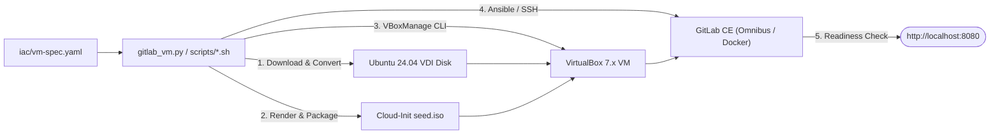

# GitLab on VirtualBox (`gitlab`)

> Declarative Infrastructure-as-Code (IaC) templates, Python CLI orchestrator, and standalone Bash scripts to provision an Ubuntu 24.04 LTS VirtualBox VM and deploy a self-hosted GitLab CE server.

`gitlab` automates the full lifecycle of a local GitLab Community Edition (CE) instance running inside an Oracle VirtualBox 7.x virtual machine. It replaces manual ISO installations and ad-hoc GUI configuration with a single declarative specification (`iac/vm-spec.yaml`), `NoCloud` cloud-init image seeding, `VBoxManage` CLI automation, and idempotent Ansible or SSH-based GitLab provisioning. It is not a cloud-provider Terraform module or a multi-node Kubernetes cluster installer; it targets reproducible, single-VM GitLab environments on macOS (`arm64` / `x86_64`) and Linux (`x86_64` / `arm64`) workstations.

---

## Quick Start

```bash
# 1. Clone the repository
git clone git@github.com:bsommers/gitlab.git
cd gitlab

# 2. (Optional) Customize VM resources, ports, or GitLab credentials
$EDITOR iac/vm-spec.yaml

# 3. Create the Linux VM, provision GitLab CE, and print the connection URL
./gitlab_vm.py up
```

Visit `http://localhost:8080` — you will see the GitLab sign-in screen. Log in with username `root` and the initial password configured in `iac/vm-spec.yaml` (default: `GitLabRoot!2026`).

---

## What It Does

- **Provisions VirtualBox Linux VMs via CLI (`VBoxManage`)**: Downloads the official Ubuntu 24.04 LTS (`noble`) cloud image matching the host CPU architecture (`arm64` or `amd64`), converts and resizes it to a 40 GB VDI disk via `qemu-img` and `VBoxManage`, and boots the VM headlessly with EFI firmware and VirtIO storage/networking.
- **Bootstraps Guest OS via Cloud-Init (`NoCloud`)**: Generates a `cidata` ISO image containing rendered `user-data` and `meta-data` templates (`iac/cloud-init/`), injecting a dedicated Ed25519 SSH keypair, configuring a 4 GB swapfile, applying kernel `sysctl` parameters (`vm.swappiness=10`, `kernel.shmall=4194304`), and enabling `openssh-server`.
- **Deploys GitLab CE via Omnibus or Docker Compose**: Provisions GitLab Community Edition inside the VM using either the idempotent Ansible playbook (`iac/ansible/playbook.yml`) or the standalone Bash installer (`scripts/install-gitlab.sh`), with single-VM memory tuning for Puma (`worker_processes=2`) and Sidekiq (`concurrency=10`).
- **Configures Host-to-Guest NAT Port Forwarding**: Maps host ports `8080` (HTTP), `8443` (HTTPS), `2222` (VM SSH), and `2224` (Git SSH) to the guest VM out of the box, with optional secondary Bridged or Host-Only network adapters.
- **Discovers and Verifies Connection URLs**: Inspects live VirtualBox NAT forwarding rules via `VBoxManage showvminfo --machinereadable`, probes HTTP readiness on `/users/sign_in`, and outputs human-readable banners, raw URLs (`--raw`), or machine-readable JSON (`--json`).

---

## Architecture Overview

```text
          ┌─────────────────────────────────────────────────────────────────┐
          │                    Host Workstation (macOS / Linux)             │
          │                                                                 │
  YAML    │  ┌──────────────────┐      ┌─────────────────────────────────┐  │
 ────────►│  │  iac/vm-spec.yaml│─────►│  gitlab_vm.py / scripts/*.sh    │  │
          │  └──────────────────┘      └───────┬─────────────────┬───────┘  │
          │                                    │                 │          │
          │                         VBoxManage │                 │ Ansible  │
          │                         + hdiutil  │                 │ or SSH   │
          └────────────────────────────────────┼─────────────────┼──────────┘
                                               │                 │
                                     ╔═════════▼═════════════════▼══════════╗
                                     ║   VirtualBox 7.x VM (gitlab-server)  ║
                                     ║   Ubuntu 24.04 LTS (EFI + VirtIO)    ║
                                     ║                                      ║
                                     ║  ┌──────────────┐  ┌──────────────┐  ║
                                     ║  │  cloud-init  │  │  GitLab CE   │  ║
                                     ║  │ (seed.iso)   │  │ :8080 / :22  │  ║
                                     ║  └──────────────┘  └──────────────┘  ║
                                     ╚══════════════════════════════════════╝
```



---

## Project Structure

```text
gitlab/
├── gitlab_vm.py                        — Python 3 CLI orchestrator and lifecycle manager
├── iac/
│   ├── vm-spec.yaml                    — Declarative VM hardware, network, and GitLab spec
│   ├── ansible/
│   │   ├── ansible.cfg                 — Ansible SSH pipelining and inventory settings
│   │   ├── inventory.ini.tmpl          — Dynamic Ansible host & variable template
│   │   └── playbook.yml                — Idempotent playbook for Omnibus & Docker GitLab
│   ├── cloud-init/
│   │   ├── meta-data.yaml.tmpl         — NoCloud instance-id and local-hostname template
│   │   └── user-data.yaml.tmpl         — Cloud-config users, SSH keys, swap, and sysctl
│   └── docker/
│       └── docker-compose.yml.tmpl     — Docker Compose template for containerized GitLab
├── scripts/
│   ├── deploy-all.sh                   — End-to-end wrapper invoking gitlab_vm.py up
│   ├── create-vm.sh                    — Standalone Bash VM creator using VBoxManage
│   ├── install-gitlab.sh               — Standalone Bash GitLab installer (remote SSH or --local)
│   └── show-url.sh                     — Wrapper displaying GitLab URL, status, and credentials
└── docs/
    ├── ARCHITECTURE.md                 — System design, component map, data flows, decisions
    ├── PURPOSE.md                      — Problem statement, goals, non-goals, trade-offs
    ├── HOWTO.md                        — Task-oriented operational recipes and troubleshooting
    └── brochure.md                     — Executive overview and visual architecture showcase
```

---

## Configuration

Configuration is managed declaratively in [`iac/vm-spec.yaml`](iac/vm-spec.yaml) for [`gitlab_vm.py`](gitlab_vm.py) and via environment variables or CLI flags for the standalone Bash scripts in [`scripts/`](scripts/).

### Declarative Spec Keys (`iac/vm-spec.yaml`)

| Key | Required | Default | Description |
|-----|----------|---------|-------------|
| `vm.name` | Yes | `gitlab-server` | VirtualBox VM name registered via `VBoxManage` |
| `vm.ostype` | No | `auto` | VirtualBox OS type (`Ubuntu24_LTS_arm64` or `Ubuntu24_LTS_64`) |
| `vm.cpus` | No | `4` | Number of virtual CPU cores allocated to the VM |
| `vm.memory_mb` | No | `8192` | RAM allocated to the VM in MiB |
| `vm.disk_size_gb` | No | `40` | Virtual disk capacity in GiB |
| `vm.vram_mb` | No | `33` | Video memory in MiB (`vmsvga` controller) |
| `vm.firmware` | No | `efi` | Guest boot firmware (`efi` or `bios`) |
| `image.codename` | No | `noble` | Ubuntu LTS release codename (`24.04`) |
| `image.arch` | No | `auto` | Cloud image architecture (`arm64` or `amd64`) |
| `network.adapter1.port_forwards.ssh.host_port` | No | `2222` | Host TCP port forwarded to guest SSH port `22` |
| `network.adapter1.port_forwards.http.host_port` | No | `8080` | Host TCP port forwarded to GitLab HTTP listen port |
| `network.adapter1.port_forwards.https.host_port` | No | `8443` | Host TCP port forwarded to GitLab HTTPS listen port |
| `network.adapter1.port_forwards.git_ssh.host_port` | No | `2224` | Host TCP port forwarded to Git SSH port `22` |
| `auth.ssh_user` | No | `ubuntu` | Default administrative user provisioned by `cloud-init` |
| `auth.ssh_key_path` | No | `.state/ssh/id_ed25519` | Path to auto-generated Ed25519 SSH private key |
| `auth.hostname` | No | `gitlab.local` | Guest VM FQDN / hostname |
| `gitlab.install_method` | No | `omnibus` | Provisioning backend: `omnibus` (APT package) or `docker` |
| `gitlab.edition` | No | `gitlab-ce` | GitLab package/image edition (`gitlab-ce` or `gitlab-ee`) |
| `gitlab.external_protocol` | No | `http` | Protocol used in `external_url` (`http` or `https`) |
| `gitlab.external_host` | No | `localhost` | Hostname or IP used in `external_url` |
| `gitlab.external_port` | No | `8080` | Port used in `external_url` and `nginx['listen_port']` |
| `gitlab.ssh_port` | No | `2222` | Port set in `gitlab_rails['gitlab_shell_ssh_port']` |
| `gitlab.initial_root_password` | No | `GitLabRoot!2026` | Initial password for the `root` administrator account |
| `gitlab.puma_workers` | No | `2` | Number of Puma worker processes (`puma['worker_processes']`) |
| `gitlab.sidekiq_concurrency` | No | `10` | Sidekiq background job concurrency (`sidekiq['concurrency']`) |
| `gitlab.prometheus_monitoring_enable` | No | `false` | Toggle embedded Prometheus monitoring stack |

### Bash Script Environment Variables (`scripts/create-vm.sh` & `scripts/install-gitlab.sh`)

| Variable | Required | Default | Description |
|----------|----------|---------|-------------|
| `VM_NAME` | No | `gitlab-server` | Target VirtualBox VM name |
| `VM_CPUS` | No | `4` | Virtual CPU count |
| `VM_MEMORY_MB` | No | `8192` | VM memory in MiB |
| `VM_DISK_GB` | No | `40` | VDI disk size in GiB |
| `SSH_HOST` | No | `127.0.0.1` | Target SSH host for provisioning |
| `SSH_HOST_PORT` / `SSH_PORT` | No | `2222` | Host port forwarded to guest SSH |
| `HTTP_HOST_PORT` / `GITLAB_EXTERNAL_PORT` | No | `8080` | Host and guest HTTP port for GitLab |
| `HTTPS_HOST_PORT` | No | `8443` | Host port forwarded to guest HTTPS |
| `GIT_SSH_HOST_PORT` | No | `2224` | Host port forwarded to Git SSH |
| `GITLAB_INSTALL_METHOD` | No | `omnibus` | `omnibus` or `docker` |
| `GITLAB_EDITION` | No | `gitlab-ce` | `gitlab-ce` or `gitlab-ee` |
| `GITLAB_EXTERNAL_URL` | No | `http://localhost:8080` | Full `external_url` written to `/etc/gitlab/gitlab.rb` |
| `GITLAB_INITIAL_ROOT_PASSWORD` | No | `GitLabRoot!2026` | Initial `root` password (minimum 8 characters) |
| `DRY_RUN` | No | `false` | Print commands without executing (`true` or `false`) |

---

## Development

```bash
# Verify Python syntax
python3 -m py_compile gitlab_vm.py

# Verify Bash script syntax
bash -n scripts/create-vm.sh scripts/install-gitlab.sh scripts/show-url.sh scripts/deploy-all.sh

# Verify Ansible playbook syntax
ansible-playbook --syntax-check -i "localhost," iac/ansible/playbook.yml

# Run full lifecycle dry-run (no VM created, prints exact VBoxManage & Ansible commands)
./gitlab_vm.py --dry-run up
./scripts/create-vm.sh --dry-run
./scripts/install-gitlab.sh --dry-run
```

---

## Deployment

Deploy or manage the VirtualBox GitLab instance using either the Python CLI orchestrator or the standalone Bash scripts:

```bash
# Option A: Python CLI Orchestrator
./gitlab_vm.py create-vm                  # 1. Create and boot the VirtualBox Linux VM
./gitlab_vm.py provision                  # 2. Provision GitLab inside the VM (Ansible or SSH)
./gitlab_vm.py url                        # 3. Show connection URL, status, and credentials

# Option B: Standalone Bash Scripts
./scripts/create-vm.sh                    # 1. Create VM via VBoxManage CLI
./scripts/install-gitlab.sh               # 2. Install GitLab CE over SSH
./scripts/show-url.sh                     # 3. Display connection URL

# Lifecycle management
./gitlab_vm.py ssh                        # Open interactive SSH session into the VM
./gitlab_vm.py stop                       # Gracefully shut down the VM via ACPI power button
./gitlab_vm.py start                      # Start the VM in headless mode
./gitlab_vm.py destroy                    # Power off and delete the VM and all attached media
```

---

## Documentation

| Document | Description |
|----------|-------------|
| [Architecture](docs/ARCHITECTURE.md) | System design, component map, data flows, state machine, key decisions |
| [Purpose](docs/PURPOSE.md) | Why this project exists, goals, non-goals, trade-offs |
| [How-To Guide](docs/HOWTO.md) | Task-oriented guide: setup, customize, switch Omnibus/Docker, debug |
| [Product Brochure](docs/brochure.md) | Executive overview, value pillars, and visual system architecture |

---

## Contributing

1. Create a feature branch (`git checkout -b feat/your-change`).
2. Validate Python, Bash, and Ansible syntax (`python3 -m py_compile gitlab_vm.py && bash -n scripts/*.sh`).
3. Verify command generation with `./gitlab_vm.py --dry-run up`.
4. Submit a pull request against `main`.

---

## License

MIT License — see repository for details.
