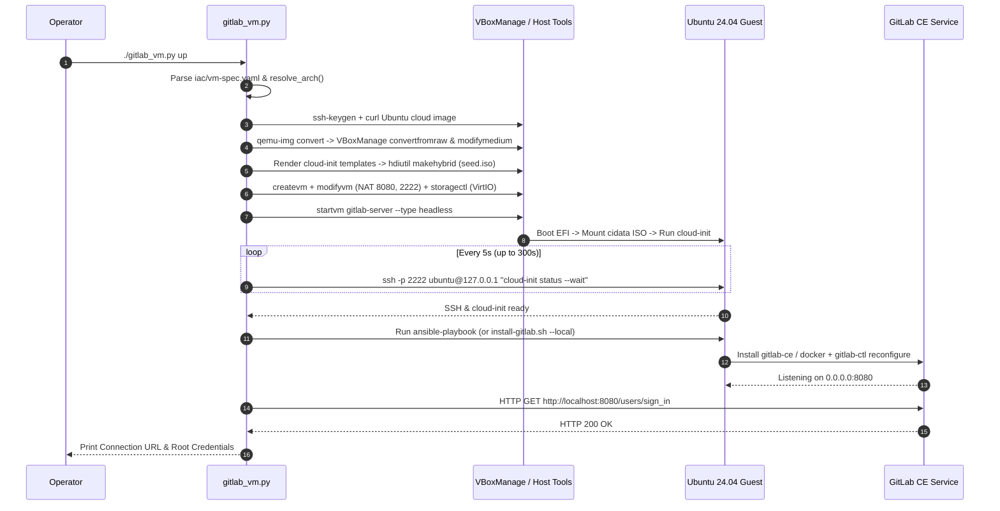
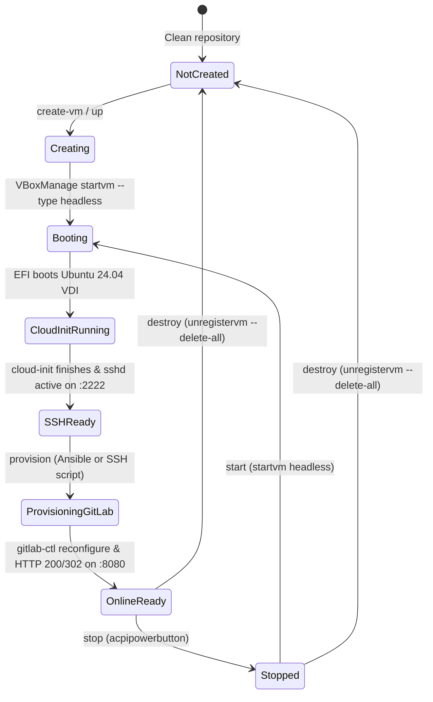
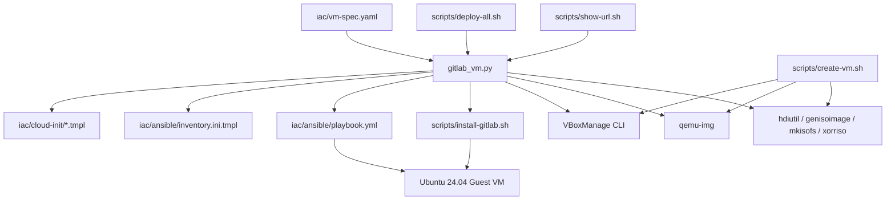

# Architecture

## System Overview

`gitlab` is a declarative, CLI-driven infrastructure provisioning pipeline that creates a Linux VM in Oracle VirtualBox and deploys a self-hosted GitLab Community Edition (CE) server inside it. It is a local hypervisor automation tool, not a cloud-hosted SaaS wrapper or a multi-node orchestrator. Its central architectural principle is **two-phase declarative convergence**:
1. **Phase 1 (Hypervisor & Guest Bootstrap)**: `VBoxManage` constructs the virtual hardware and attaches an immutable Ubuntu 24.04 cloud disk alongside a generated `NoCloud` (`cidata`) ISO that bootstraps SSH, networking, swap, and kernel parameters on first boot.
2. **Phase 2 (Application Configuration)**: Once the SSH boundary becomes reachable, Ansible (`iac/ansible/playbook.yml`) or the standalone Bash installer (`scripts/install-gitlab.sh`) converges the GitLab application state inside the guest VM and verifies HTTP readiness.

### Top-Level Architecture

```text
          ┌─────────────────────────────────────────────────────────────────────┐
          │                        gitlab Orchestration Layer                   │
          │                                                                     │
  Spec    │  ┌──────────────────┐      ┌──────────────────┐      ┌───────────┐  │  URL / JSON
 ────────►│  │  iac/vm-spec.yaml│─────►│   gitlab_vm.py   │─────►│ Discovery │  │────────────►
          │  └──────────────────┘      └────────┬─────────┘      └─────▲─────┘  │
          │                                     │                      │        │
          │              ┌──────────────────────┼──────────────────────┤        │
          │              ▼                      ▼                      │        │
          │     ┌─────────────────┐    ┌─────────────────┐             │        │
          │     │ VM Builder      │    │ Provisioner     │             │        │
          │     │ (create_vm)     │    │ (Ansible / SSH) │             │        │
          │     └────────┬────────┘    └────────┬────────┘             │        │
          └──────────────┼──────────────────────┼──────────────────────┼────────┘
                         │                      │                      │
              ╔══════════▼══════════╗╔══════════▼══════════╗╔══════════╩══════════╗
              ║  VBoxManage +       ║║  Guest SSH :2222    ║║  GitLab HTTP :8080  ║
              ║  qemu-img + hdiutil ║║  (Ubuntu 24.04 VM)  ║║  (/-/readiness)     ║
              ╚═════════════════════╝╚═════════════════════╝╚═════════════════════╝
```

---

## Component Map

### 1. Python CLI Orchestrator (`gitlab_vm.py`)

**Location**: `gitlab_vm.py`
**Responsibility**: Parses `iac/vm-spec.yaml`, resolves host CPU architecture (`arm64` vs `amd64`), renders IaC templates, executes `VBoxManage` and provisioning subprocesses, and performs HTTP health discovery.
**Interfaces**:
- CLI subcommands: `up`, `create-vm`, `provision`, `url` (`status`, `info`), `ssh`, `start`, `stop`, `destroy`
- Global flags: `-c / --config <path>`, `--dry-run`, `-v / --verbose`
- Core functions: `load_yaml_file()`, `resolve_arch()`, `ensure_ssh_keypair()`, `build_cidata_iso()`, `create_vm()`, `wait_for_ssh()`, `provision_gitlab()`, `discover_connection_details()`, `show_connection_url()`
**Dependencies**: Python 3.9+ standard library (`argparse`, `subprocess`, `urllib.request`, `string`, `shlex`), optional `PyYAML` (includes built-in fallback parser `_simple_yaml_parse()`), and external binaries `VBoxManage`, `qemu-img`, `curl`, `ssh`, `ssh-keygen`, `hdiutil`/`genisoimage`/`mkisofs`/`xorriso`.

---

### 2. Declarative Infrastructure Templates (`iac/`)

**Location**: `iac/`
**Responsibility**: Defines the desired state of the VirtualBox VM, `cloud-init` first-boot configuration, Ansible playbook tasks, and Docker Compose service definition.
**Interfaces**:
- `iac/vm-spec.yaml`: Top-level schema (`vm`, `image`, `network`, `auth`, `gitlab` sections).
- `iac/cloud-init/*.tmpl`: Variable placeholders (`${INSTANCE_ID}`, `${HOSTNAME}`, `${SSH_USER}`, `${SSH_PUBLIC_KEY}`).
- `iac/ansible/inventory.ini.tmpl` & `iac/ansible/playbook.yml`: Ansible variables (`gitlab_install_method`, `gitlab_edition`, `gitlab_external_url`, `gitlab_external_port`, `gitlab_ssh_port`, `gitlab_initial_root_password`, `gitlab_puma_workers`, `gitlab_sidekiq_concurrency`, `gitlab_prometheus_enable`).
**Dependencies**: Consumed by `gitlab_vm.py` and `ansible-playbook`.

**Internal structure**:
```text
iac/
├── vm-spec.yaml                    — Single source of truth for VM and GitLab parameters
├── ansible/
│   ├── ansible.cfg                 — Disables host_key_checking, enables SSH pipelining
│   ├── inventory.ini.tmpl          — Template rendered to .state/ansible/inventory.ini
│   └── playbook.yml                — Converges Omnibus or Docker GitLab inside the guest
├── cloud-init/
│   ├── meta-data.yaml.tmpl         — Template rendered to .state/cloud-init/<vm>/meta-data
│   └── user-data.yaml.tmpl         — Template rendered to .state/cloud-init/<vm>/user-data
└── docker/
    └── docker-compose.yml.tmpl     — Reference Docker Compose template for GitLab CE
```

---

### 3. Standalone Bash Automation (`scripts/`)

**Location**: `scripts/`
**Responsibility**: Provides shell-native equivalents for creating the VirtualBox VM, installing GitLab CE (remotely via SSH or locally inside the guest with `--local`), and displaying connection URLs without requiring Ansible.
**Interfaces**:
- `scripts/create-vm.sh`: Flags `--name`, `--cpus`, `--memory`, `--disk`, `--http-port`, `--ssh-port`, `--dry-run`
- `scripts/install-gitlab.sh`: Flags `--local`, `--method <omnibus|docker>`, `--external-url`, `--port`, `--ssh-port`, `--root-password`, `--dry-run`
- `scripts/show-url.sh`: Passes flags (`--raw`, `--json`) to `gitlab_vm.py url`
- `scripts/deploy-all.sh`: Passes flags to `gitlab_vm.py up`
**Dependencies**: `bash`, `VBoxManage`, `qemu-img`, `curl`, `ssh`, `scp`, `hdiutil`/`genisoimage`/`mkisofs`/`xorriso`.

**Internal structure**:
```text
scripts/
├── create-vm.sh                    — Pure Bash VirtualBox VM and cloud-init ISO builder
├── install-gitlab.sh               — Dual-mode (remote SSH dispatcher + local guest installer)
├── show-url.sh                     — CLI wrapper for connection URL discovery
└── deploy-all.sh                   — End-to-end pipeline wrapper
```

---

## Data Flow

### Flow 1: End-to-End VM Creation & GitLab Provisioning (`./gitlab_vm.py up`)

```text
  Operator        gitlab_vm.py        VBoxManage / Host CLI       Ubuntu Guest VM
     │                 │                        │                        │
     │── up ──────────►│                        │                        │
     │                 │── load vm-spec.yaml    │                        │
     │                 │── ssh-keygen ─────────►│                        │
     │                 │── curl cloudimg.img ──►│                        │
     │                 │── qemu-img + VDI ─────►│                        │
     │                 │── hdiutil seed.iso ───►│                        │
     │                 │── createvm/modifyvm ──►│                        │
     │                 │── startvm headless ───►│── boots EFI + VirtIO ─►│
     │                 │                        │                        │── cloud-init runs
     │                 │── poll SSH :2222 ──────┼───────────────────────►│
     │                 │◄── "ready" ────────────┼────────────────────────│
     │                 │── ansible-playbook ────┼───────────────────────►│── installs gitlab-ce
     │                 │   (or scp/ssh script)  │                        │── gitlab-ctl reconfigure
     │                 │── GET /users/sign_in ─►│───────────────────────►│
     │                 │◄── HTTP 200 / 302 ─────┼────────────────────────│
     │◄── URL banner ──│                        │                        │
```

1. **Specification Load & Architecture Detection** — `gitlab_vm.py` reads `iac/vm-spec.yaml` and calls `resolve_arch()` to map the host platform (`platform.machine()`) to either `("arm64", "Ubuntu24_LTS_arm64")` or `("amd64", "Ubuntu24_LTS_64")`.
2. **SSH Keypair Generation** — `ensure_ssh_keypair()` checks `.state/ssh/id_ed25519` and invokes `ssh-keygen -t ed25519` if missing.
3. **Cloud Image Caching & Disk Conversion** — Downloads `noble-server-cloudimg-{arch}.img` to `.state/images/`, converts the QCOW2 image to raw via `qemu-img convert`, converts raw to `.state/vms/<vm>/<vm>.vdi` via `VBoxManage convertfromraw`, and resizes the medium to `40960` MiB via `VBoxManage modifymedium disk --resize`.
4. **Cloud-Init Seed ISO Generation** — Renders `meta-data.yaml.tmpl` and `user-data.yaml.tmpl` into `.state/cloud-init/<vm>/` with the generated SSH public key and packages them into `seed.iso` with volume label `cidata`.
5. **VirtualBox VM Registration & Boot** — Calls `VBoxManage createvm`, `modifyvm` (configuring EFI, CPUs, RAM, `virtio` NIC, and NAT port-forwarding rules), `storagectl` (`VirtIO`), `storageattach` (port 0 = VDI disk, port 1 = `seed.iso`), and `startvm --type headless`.
6. **SSH & Cloud-Init Barrier** — `wait_for_ssh()` polls `127.0.0.1:2222` every 5 seconds until SSH authentication succeeds and `cloud-init status --wait` exits inside the guest.
7. **GitLab Convergence** — `provision_gitlab()` renders `.state/ansible/inventory.ini` and executes `ansible-playbook` (or uploads `scripts/install-gitlab.sh` via `scp` and runs it with `sudo` when `--provisioner ssh` is selected).
8. **URL Discovery & Readiness Verification** — `discover_connection_details()` queries `VBoxManage showvminfo --machinereadable` to confirm active NAT port forwards, probes `http://localhost:8080/users/sign_in`, and prints the connection table.



---

### Flow 2: Connection URL Discovery (`./gitlab_vm.py url` / `./scripts/show-url.sh`)

```text
  gitlab_vm.py           VBoxManage CLI            GitLab HTTP (:8080)
       │                       │                            │
       │── showvminfo ────────►│                            │
       │◄── VMState & NAT PF ──│                            │
       │── GET /users/sign_in ─┼───────────────────────────►│
       │◄── HTTP 200 / 302 ────┼────────────────────────────│
       │── format banner/JSON  │                            │
```

1. **Hypervisor Inspection** — `get_vm_info()` executes `VBoxManage showvminfo <vm_name> --machinereadable` and parses `VMState` and all `Forwarding(N)="name,proto,hostip,hostport,guestip,guestport"` entries.
2. **Port Resolution** — If live NAT rules exist on the VM for `http` or `ssh`, their actual `hostport` values override the static defaults from `iac/vm-spec.yaml`.
3. **Readiness Probe** — `urllib.request.urlopen()` sends a `GET` request with a 3-second timeout to `{web_url}/users/sign_in`, treating HTTP `200` or `302` as `http_ready = True`.

---

## Data Model

The system persists local runtime artifacts under `.state/` (git-ignored) and reads declarative configuration from `iac/vm-spec.yaml`:

```text
iac/vm-spec.yaml (Declarative Input)
  ├── vm          : { name, ostype, cpus, memory_mb, disk_size_gb, vram_mb, firmware, rtc_use_utc }
  ├── image       : { release, codename, arch, base_url }
  ├── network     : { adapter1: { type, nic_type, port_forwards: { ssh, http, https, git_ssh } }, adapter2 }
  ├── auth        : { ssh_user, ssh_key_path, hostname }
  └── gitlab      : { install_method, edition, external_host, external_protocol, external_port,
                      ssh_port, initial_root_password, tune_for_vm, puma_workers,
                      sidekiq_concurrency, prometheus_monitoring_enable }

.state/ (Generated Runtime State)
  ├── ssh/
  │   ├── id_ed25519              : Ed25519 private key (0600) for host->guest SSH
  │   └── id_ed25519.pub          : Public key injected into cloud-init user-data
  ├── images/
  │   └── noble-server-cloudimg-*.img : Cached upstream Ubuntu 24.04 QCOW2 image
  ├── cloud-init/<vm_name>/
  │   ├── meta-data               : Rendered instance metadata
  │   └── user-data               : Rendered cloud-config file
  ├── ansible/
  │   └── inventory.ini           : Rendered Ansible inventory & host vars
  └── vms/<vm_name>/
      ├── <vm_name>.vbox          : VirtualBox VM XML descriptor
      ├── <vm_name>.vdi           : Resized 40 GB VirtualBox disk image
      └── seed.iso                : Hybrid ISO9660/Joliet disk labeled "cidata"
```

---

## State Machine



---

## Dependency Graph



---

## Key Design Decisions

### 1. Ubuntu Cloud Image + `NoCloud` Seed ISO over Unattended Debian/Ubuntu Installer ISO

**Context**: Creating a Linux VM from a standard 2.5 GB Ubuntu Server installer ISO via `VBoxManage unattended install` requires slow full-OS package extraction on every VM build (often 15–25 minutes) and has brittle architecture-specific preseed/autoinstall syntax differences in VirtualBox 7.1.
**Options considered**:
- Standard Ubuntu installer ISO with `VBoxManage unattended install`
- Vagrant (`Vagrantfile` + `vagrant-vbguest`)
- Official Ubuntu Cloud Image (`noble-server-cloudimg`) converted to VDI + `NoCloud` `seed.iso`
**Decision**: Use the official Ubuntu 24.04 LTS Cloud Image converted to `.vdi` paired with a generated `cidata` ISO.
**Consequences**: First boot reaches SSH readiness in ~45–90 seconds, works identically across `arm64` and `amd64`, caches the ~600 MB cloud image locally in `.state/images/`, and requires zero Vagrant dependency.

### 2. VirtIO Storage and Networking (`--controller VirtIO`, `--nictype1 virtio`)

**Context**: VirtualBox 7.1 supports both `x86_64` and Apple Silicon (`arm64` / `armv8virtual` chipset). Legacy default controllers like `PIIX4` IDE or `82540EM` Intel PRO/1000 NICs fail or underperform on the `armv8virtual` chipset.
**Options considered**:
- Architecture-specific branching between SATA/Intel NICs on `x86_64` and VirtIO on `arm64`
- Unified VirtIO storage controller (`--add virtio --controller VirtIO`) and VirtIO paravirtualized NIC (`--nictype1 virtio`) across both architectures
**Decision**: Standardize on `VirtIO` for both storage (HDD on port 0, `seed.iso` DVD on port 1) and networking on all architectures.
**Consequences**: Eliminates architecture-specific storage/NIC bugs, reduces hypervisor I/O overhead, and works natively with Ubuntu 24.04's built-in kernel VirtIO drivers.

### 3. Dual Provisioning Engine (Ansible IaC with Automatic SSH Script Fallback)

**Context**: Infrastructure teams often want declarative Ansible playbooks (`iac/ansible/playbook.yml`), while individual developers may want to deploy without installing Ansible on their host machine.
**Options considered**:
- Require Ansible exclusively
- Use shell scripts exclusively
- Provide both `iac/ansible/playbook.yml` and `scripts/install-gitlab.sh`, with `gitlab_vm.py` auto-detecting `ansible-playbook` (`--provisioner auto`) and falling back to SSH script execution
**Decision**: Support both Ansible and direct SSH script provisioning from the same `iac/vm-spec.yaml` configuration.
**Consequences**: Zero mandatory Python/host dependencies beyond `VBoxManage` and `qemu-img`, while preserving full Ansible idempotency when `ansible-playbook` is available.

### 4. VM-Tuned GitLab Omnibus Configuration + 4 GB Swap

**Context**: Default GitLab Omnibus settings assume a dedicated server with 16+ GB RAM and spawn numerous Puma workers, Sidekiq threads, and a full Prometheus/Grafana monitoring stack that can exhaust an 8 GB VM.
**Options considered**:
- Leave `/etc/gitlab/gitlab.rb` at upstream defaults
- Explicitly tune `puma['worker_processes'] = 2`, `sidekiq['concurrency'] = 10`, `prometheus_monitoring['enable'] = false`, and provision a 4 GB swapfile with `vm.swappiness = 10`
**Decision**: Apply VM memory tuning by default (`tune_for_vm: true`) and configure a 4 GB swapfile in `cloud-init`.
**Consequences**: GitLab CE runs reliably within an 8 GB RAM VM allocation without OOM kills during `gitlab-ctl reconfigure`.

---

## External Dependencies

| Dependency | Type | Purpose | Version |
|------------|------|---------|---------|
| `VBoxManage` | Hypervisor CLI | Create, configure, start, inspect, and destroy VirtualBox VMs | VirtualBox 7.0+ / 7.1+ |
| `qemu-img` | Disk Utility | Convert Ubuntu QCOW2 `.img` cloud image to raw format before VDI conversion | QEMU 8.x+ / 9.x+ |
| `hdiutil` / `genisoimage` / `mkisofs` / `xorriso` | ISO Builder | Package `user-data` and `meta-data` into a `cidata` Joliet/ISO9660 image | OS built-in (macOS) or standard Linux package |
| `ansible-playbook` | IaC Engine (Optional) | Execute `iac/ansible/playbook.yml` over SSH | Ansible Core 2.14+ |
| Ubuntu 24.04 Cloud Image | Upstream OS Image | Base guest OS (`noble-server-cloudimg-{arm64,amd64}.img`) | 24.04 LTS (`noble`) |
| GitLab CE Package / Image | Application | `packages.gitlab.com/gitlab/gitlab-ce` APT repo or `gitlab/gitlab-ce:latest` Docker image | Latest stable CE |

---

## Performance Characteristics

- **Image Caching**: `create_vm()` and `scripts/create-vm.sh` store downloaded Ubuntu cloud images in `.state/images/`. Subsequent `destroy` and `create-vm` cycles skip the ~600 MB network download.
- **SSH Multiplexing & Pipelining**: `iac/ansible/ansible.cfg` enables `pipelining = True` and `ControlMaster=auto -o ControlPersist=60s`, reducing SSH round-trips during Ansible task execution.
- **Memory Footprint**: Disabling the embedded Prometheus stack (`prometheus_monitoring_enable: false`) and capping `puma_workers: 2` reduces idle guest memory usage by ~1.5–2.0 GB.

---

## Security Boundaries

- **Host-to-Guest Network Boundary**: By default (`network.adapter1`), the VM is placed behind a VirtualBox NAT firewall (`--nic1 nat`). Only explicitly forwarded ports are reachable from the host:
  - `127.0.0.1:2222 -> Guest :22` (bound strictly to loopback `127.0.0.1` in `iac/vm-spec.yaml` and `scripts/create-vm.sh` so external LAN hosts cannot reach the VM management SSH port).
  - `0.0.0.0:8080 -> Guest :8080` (GitLab HTTP web interface).
  - `0.0.0.0:8443 -> Guest :8443` (GitLab HTTPS web interface).
  - `0.0.0.0:2224 -> Guest :22` (Git SSH clone port).
- **SSH Authentication**: Password authentication is not used for provisioning; `ensure_ssh_keypair()` generates a project-local Ed25519 keypair in `.state/ssh/id_ed25519` with `0600` file permissions (`gitlab_vm.py:157`) and injects only the public key into `cloud-init`.
- **Initial Root Password**: Stored in `iac/vm-spec.yaml` (`gitlab.initial_root_password`) for local automation convenience. For shared network deployments, operators should rotate this password immediately after first login or set `initial_root_password: ""` so GitLab generates a random password in `/etc/gitlab/initial_root_password`.

---

## Known Limitations

- **Single-VM Topology**: The IaC specification targets a single VirtualBox VM (`gitlab-server`). High-availability multi-node PostgreSQL/Gitaly/Redis clusters are outside the scope of this repository.
- **Disk Conversion Intermediate Space**: Converting the QCOW2 cloud image to `.vdi` temporarily creates a sparse `.raw` file (`gitlab_vm.py:293–298`) before unlinking it immediately after `VBoxManage convertfromraw` completes.
- **First-Run Omnibus Reconfigure Duration**: Installing and running `gitlab-ctl reconfigure` inside the VM takes 3–6 minutes on first boot while database migrations and asset compilation run.
