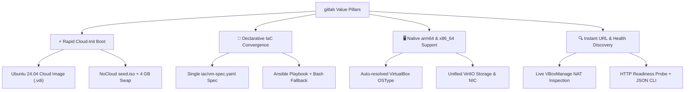
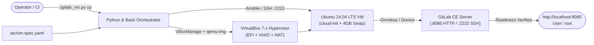

# GitLab on VirtualBox (`gitlab`) — Product Brochure

<div align="center">

```text
   ____ _ _   _          _                     __     ______            
  / ___(_) |_| |    __ _| |__     ___  _ __    \ \   / / __ )  _____  __
 | |  _| | __| |   / _` | '_ \   / _ \| '_ \    \ \ / /|  _ \ / _ \ \/ /
 | |_| | | |_| |__| (_| | |_) | | (_) | | | |    \ V / | |_) | (_) >  < 
  \____|_|\__|_____\__,_|_.__/   \___/|_| |_|     \_/  |____/ \___/_/\_\
```

**Declarative Infrastructure-as-Code & CLI Automation for Self-Hosted GitLab on VirtualBox**


</div>

---

## 1. Product & Marketing Hook

> **"Stop clicking through hypervisor wizards and debugging 20-minute ISO installs—spin up a fully configured, memory-tuned GitLab CE server in VirtualBox from a single YAML spec and one CLI command."**

Setting up a local self-hosted GitLab server for CI/CD testing, webhook development, or administrative sandboxing shouldn't require half an afternoon of manual VirtualBox GUI tweaks, port-forwarding guesswork, and SSH key copying. Traditional installer ISOs take 20+ minutes just to install the base operating system, and default GitLab Omnibus configurations routinely exhaust single-VM memory allocations.

`gitlab` transforms local hypervisor provisioning into a deterministic, code-first workflow. Powered by official Ubuntu 24.04 LTS Cloud Images, `NoCloud` cloud-init seeding, `VBoxManage` CLI automation, and idempotent Ansible/Bash provisioning, it takes you from an empty directory to a live GitLab server at `http://localhost:8080` automatically—across both Apple Silicon (`arm64`) and Intel/AMD (`x86_64`) workstations.

---

## 2. Target Audience

- 👨‍💻 **Software Engineers & API Integrators**: Spin up an isolated local GitLab instance on `http://localhost:8080` to test repositories, personal access tokens, webhooks, and CI/CD pipelines offline without polluting shared company servers.
- 🚀 **DevOps & Platform Engineers**: Validate `/etc/gitlab/gitlab.rb` changes, Omnibus version upgrades, backup/restore procedures, and Ansible automation in a disposable VM that can be destroyed and recreated in minutes.
- 🔒 **Security & Compliance Evaluators**: Inspect self-hosted GitLab CE configurations inside a local NAT-isolated virtual machine with dedicated Ed25519 SSH key authentication and zero external cloud footprint.

---

## 3. Purpose & Mission

| Dimension | Manual VirtualBox + GitLab Setup (Before) | `gitlab` IaC & CLI Automation (After) |
|-----------|-------------------------------------------|---------------------------------------|
| **OS Installation** | 20–25 min interactive Ubuntu Server ISO installer | ~60 sec boot using cached Ubuntu 24.04 Cloud Image + `cidata` ISO |
| **Apple Silicon (`arm64`) Support** | Fails unless EFI, `armv8virtual`, and `VirtIO` are manually configured | Auto-detects `arm64` vs `amd64` and configures `VirtIO` + EFI automatically |
| **SSH & Network Setup** | Manual NAT port-forwarding rules in GUI + manual `ssh-copy-id` | Automatic Ed25519 key generation, cloud-init injection, and NAT port mapping |
| **Memory Stability** | Default Omnibus settings OOM-kill 8 GB VMs during reconfigure | Pre-tuned Puma workers, Sidekiq concurrency, disabled Prometheus, + 4 GB swap |
| **Connection Discovery** | Digging through VM network settings and `/etc/gitlab/initial_root_password` | Instant status banner & JSON output via `./gitlab_vm.py url` |

---

## 4. Core Value Propositions & Key Capabilities



- **Declarative Single Source of Truth (`iac/vm-spec.yaml`)**: Configure vCPUs, RAM, disk size, NAT port forwards, SSH credentials, and GitLab Omnibus/Docker settings in one file.
- **Dual Provisioning Engines**: Automatically uses `ansible-playbook` (`iac/ansible/playbook.yml`) when installed, or seamlessly falls back to standalone SSH/Bash provisioning (`scripts/install-gitlab.sh`) with zero external Python library dependencies.
- **Omnibus & Docker Flexibility**: Deploy GitLab CE either as a native Ubuntu `.deb` Omnibus package (`install_method: omnibus`) or as a containerized Docker Compose stack (`install_method: docker`).
- **Safe Dry-Run Verification**: Run `./gitlab_vm.py --dry-run up` or `./scripts/create-vm.sh --dry-run` at any time to audit every `VBoxManage`, `qemu-img`, and `ansible-playbook` command before execution.

---

## 5. Visual System Architecture



---

## 6. Instant Onboarding & Quick Start

```bash
# Clone the standalone repository
git clone git@github.com:bsommers/gitlab.git
cd gitlab

# Preview the entire execution plan without creating resources
./gitlab_vm.py --dry-run up

# Create the VirtualBox Linux VM, install GitLab CE, and display the connection URL
./gitlab_vm.py up

# Or use the standalone Bash scripts directly
./scripts/create-vm.sh
./scripts/install-gitlab.sh
./scripts/show-url.sh
```

---

## 7. Where to Go for More Information

| Resource | Purpose | Direct Link |
|----------|---------|-------------|
| 📖 **Documentation Hub** | Quick start, CLI reference & configuration tables | [README.md](../README.md) |
| 🏗️ **System Architecture** | Component map, sequence diagrams, state machine & ADRs | [ARCHITECTURE.md](ARCHITECTURE.md) |
| 🎯 **Project Purpose** | Problem statement, goals, non-goals & design trade-offs | [PURPOSE.md](PURPOSE.md) |
| 🚀 **Operations & How-To Guide** | Step-by-step recipes, customization & troubleshooting | [HOWTO.md](HOWTO.md) |
